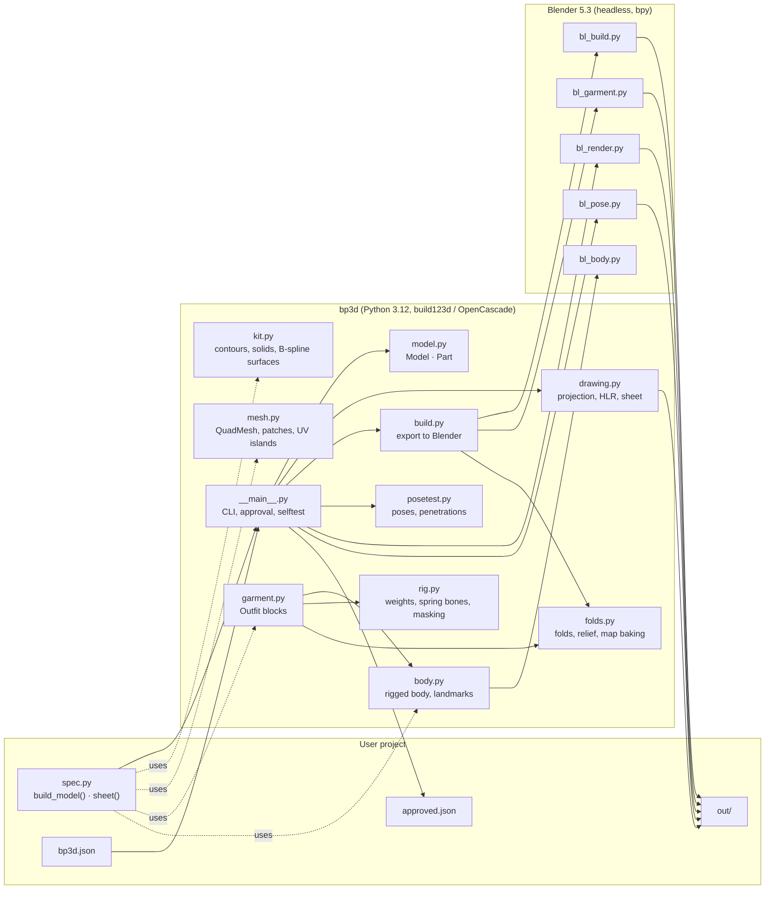
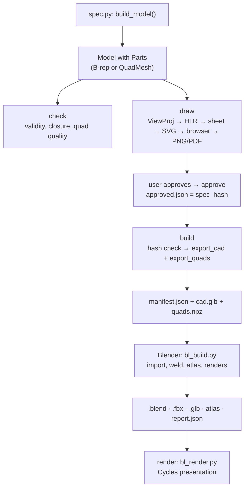
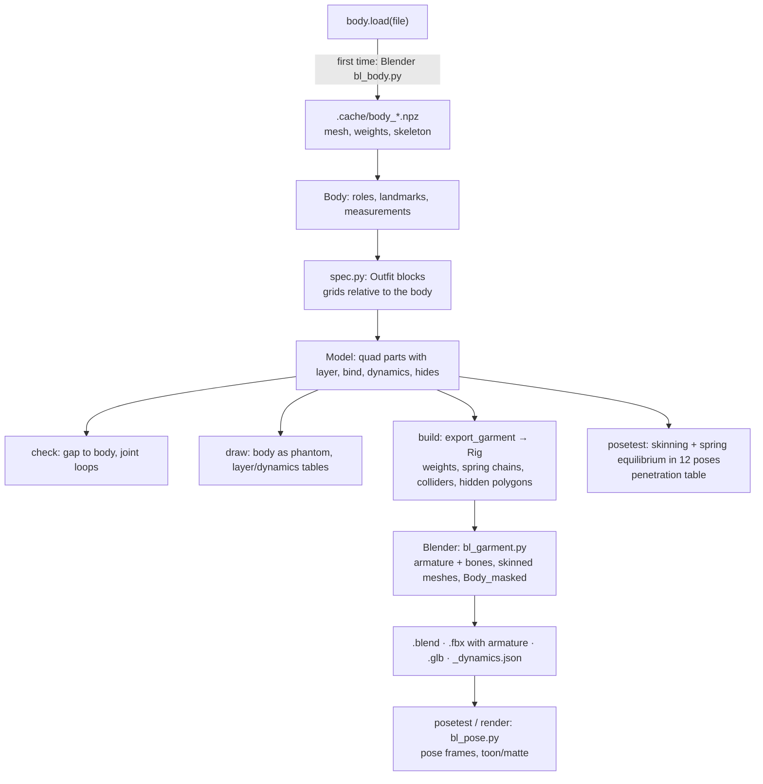

# Architecture

[Русская версия](architecture.ru.md) · [Documentation map](README.md)

How Blueprint3D is put together: the stages a specification goes through, which component owns what, how the Python side and Blender talk, and the invariants the design relies on. Function-level detail is in the [module reference](modules.en.md); files and keys in [file formats](file-formats.en.md).

## The idea

One parametric description — `spec.py` — is the single source of truth for an object. Both the drawing and the 3D model are **derived** from the same solids, so they cannot disagree. A human approves the drawing; the approval is bound to a hash of everything that defines the geometry, so the model built from an approved drawing is provably the approved geometry.

## Components

| Layer | Modules | Owns |
|---|---|---|
| Command line | `__main__.py` | Commands, spec loading, approval hash and check, project config, browser printing, selftest |
| Data model | `model.py` | `Model`, `Part`, finishes, palette, parts list (BOM) |
| Geometry | `kit.py`, `mesh.py`, `folds.py` | B-rep construction (contours, prisms, lofts, B-spline patches, shells) and quad meshes built from the same grids; folds as a displacement field and normal-map baking |
| Drawing | `drawing.py` | Projection, hidden-line removal, sections, details, dimensions, tables, title block, SVG |
| Characters | `body.py`, `garment.py`, `rig.py`, `posetest.py`, `mannequin.py` | Rigged body as data, garment blocks, binding and spring bones, pose test, code-built mannequin |
| 3D export | `build.py` | Discovering Blender, writing manifests/glTF/npz, running Blender scripts |
| Blender side | `bl_*.py` | Building `.blend`/`.fbx`/`.glb`, atlas baking, renders, body export, mannequin rebuild |

## Pipelines

### Hard-surface object

1. **Build.** `build_model()` returns a `Model`. Parts are either B-rep solids (`mesh="cad"`) or `QuadMesh` objects (`mesh="quad"`); for a quad part `Model.add` also stores `QuadMesh.brep()` — B-spline faces through the same grids — so the drawing has exact geometry to project.
2. **Check.** Each part is validated: B-rep validity and closure; for quad meshes manifoldness, winding, degenerate faces, aspect ratio and deviation from the B-spline.
3. **Draw.** Views are projected with OpenCascade hidden-line removal (exact, or polygonal with `hlr="poly"`); sections intersect B-reps with planes (quad parts are sliced as meshes); dimensions, balloons and tables are laid out in sheet millimetres; SVG is printed to PNG/PDF by a headless browser.
4. **Approve.** A person looks at the sheet and approves it; `approved.json` stores the hash of the specification and the geometry modules.
5. **Build.** The hash is checked again; CAD parts are tessellated to glTF, quad parts are written to `.npz` with atlas-packed UVs; Blender assembles the scene, welds, bakes the colour atlas, renders check images and exports.
6. **Render.** Optional presentation renders with procedural materials by finish.

### Garment

Same skeleton with three additions — the body, the rig and the pose test:

- The body is read once through Blender and cached as numpy arrays; everything else on the Python side works on those arrays.
- Garment blocks build grids **relative to body landmarks** and push them out of the body by the layer gap; the same grids become the quad mesh and the drawing B-rep.
- `Rig` transfers weights from the body surface, generates spring-bone chains and colliders, and finds body polygons covered by the garment.
- `posetest` deforms the garment with the same weights that go into the FBX and measures penetrations into the body and between layers.

## Process model

Blueprint3D runs in **two Python runtimes**: the tool's own venv (build123d, numpy, scipy) and Blender's bundled Python (`bpy`). They never import each other; they exchange files.

| Call | Blender flags | Input | Output | Success marker |
|---|---|---|---|---|
| `build` (hard-surface) | `-b --factory-startup` | `manifest.json`, `cad.glb`, `quads.npz` | model files, `report.json`, `blender.log` | `BP3D_DONE` + `report.json` exists |
| `build` (garment) | `-b --factory-startup` | same + `rig` in the manifest, `WI`/`WW` arrays | + armature, `Body_masked` | `BP3D_DONE` |
| body export | `-b --factory-startup` | body file | `.cache/body_<hash16>.npz` | `BP3D_DONE` |
| `render` (hard-surface) | `-b <model.blend>` (user profile) | — | renders, `render_<color>.json` | `BP3D_RENDER_DONE` |
| `posetest`/`render` (garment) | `-b <model.blend>` (user profile) | `_shots.json` | PNGs, `renders.json` | `BP3D_DONE` |
| `mannequin` | `-b` with `BLENDER_USER_RESOURCES` (MPFB) or `--factory-startup` | `macro.json` or `_parts.npz` + `_skeleton.json` | `bodies/<name>/<name>.blend`, preview | `BP3D_DONE` |

Rules of the boundary:
- Arguments after `--` on Blender's command line; data in files next to the output.
- A script prints its marker only after it has written everything; the Python side treats a missing marker, a non-zero exit code or a missing report as failure and shows the tail of `blender.log`.
- Blender subprocesses have no timeout.

The browser is a third external process: headless Edge/Chrome/Chromium prints the SVG to PNG (`--screenshot`) and PDF (`--print-to-pdf`). Its failures are not fatal — `draw` still writes SVG; `selftest --draw` detects a missing PNG.

## Approval and reproducibility

`spec_hash` = SHA-256 over, in order: `spec.py`, `kit.py`, `mesh.py`; for specs with a body also `body.py`, `garment.py`, `rig.py` and each body's `source_hash` (hash of the body file plus the `roles`/`landmarks` overrides). Line endings are normalised, so the hash does not depend on Git's autocrlf.

- `approve` stores it; `build` refuses when it is missing or different. `--force` builds a **draft** and marks it in `report.json` (`draft: true`).
- The hash is printed on the sheet and written to every report (`report.json`, posetest report, render JSON), so any output can be traced to the exact specification.
- Not hashed: `drawing.py`, `build.py`, `model.py`, `bl_*.py`, `bp3d.json`, helper modules next to the spec. Changing them does not invalidate approvals — keep geometry decisions out of them.
- Outputs (`out/`) are never stored in Git: they are reproducible from `spec.py` + the tool version.

## Coordinate systems

| Space | Axes | Units | Where |
|---|---|---|---|
| Specification / CAD | X back from the front point, Z up from the ground; the character's left is −Y (the character faces −X) | mm | specs, `kit`, `mesh`, `body` |
| Sheet | x right, y down from the top-left corner of the sheet | sheet mm (view scale `k` = sheet mm per model mm) | `drawing` |
| Blender scene | front faces −Y, Z up; character's left arm toward +X | m | `bl_*`; conversion `cad_to_bl(x, y, z) = (−y, x, z) · 0.001` (`bl_common`) |
| Body import | Blender → CAD `(X, Y, Z) → (Y, −X, Z) · 1000` | | `bl_body` |
| FBX | Unity axes: forward −Z, up Y, scale by units | m | `bl_build`, `bl_garment` export |
| Dynamics JSON | bone-relative fractions and metres | m | `rig.dynamics_manifest` |

## Caches and state on disk

| Path | Content | Invalidation |
|---|---|---|
| `.cache/body_<sha16>.npz` | Exported body (vertices, triangles, normals, weights, skeleton) | Keyed by the body file hash only; delete the folder after changing `bl_body.py` |
| `<object>/out/` | All outputs | Overwritten by the next run; stale files of removed parts stay — delete `out/` for a clean state |
| `examples/*/out/` | Outputs of `selftest` | Same |

## Invariants the design relies on

- **One construction, two representations.** Drawing and model come from the same solids/grids. Never draw something that is not modelled, never model something that is not drawn.
- **Grids are not resampled.** A quad mesh has exactly the rows the spec gave; topology is controlled in the spec (`spacing`, `cols`, `row_step`).
- **Outward normals.** A grid's normal `du × dv` points outward; thickness grows inward. Neighbouring patches share a row exactly; that row becomes a feature edge on the drawing and a welded seam in the mesh.
- **Approval is explicit and hashed.** No code path builds a non-draft model without a matching approval.
- **Deterministic outputs.** Same spec + same tool version → same geometry and the same hash.

## Extension points

| To add | Where | See |
|---|---|---|
| Command | `__main__.py` | [development](development.en.md#a-new-cli-command) |
| Geometry primitive / quad builder | `kit.py` / `mesh.py` | [development](development.en.md#a-geometry-function-kitpy-or-quad-builder-meshpy) |
| Sheet element | `drawing.py` | [development](development.en.md#a-sheet-key) |
| Garment block | `garment.py` | [development](development.en.md#a-garment-block) |
| Finish / material | `model.py`, `bl_render.py`, `bl_pose.py` | [development](development.en.md#a-finish) |
| Body | `bodies/` or any rigged file | [bodies/README.md](../bodies/README.md) |
| Engine integration (spring bones) | consume `<name>_dynamics.json` | [file formats](file-formats.en.md#name_dynamicsjson) |
