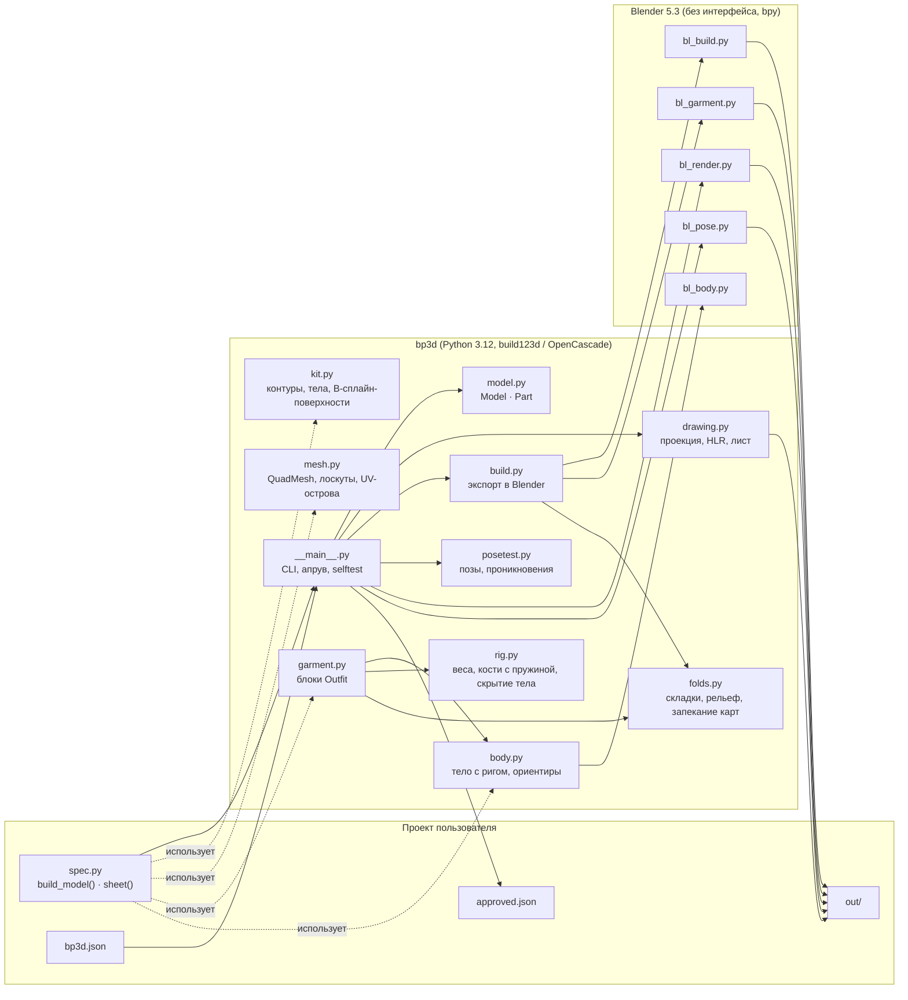
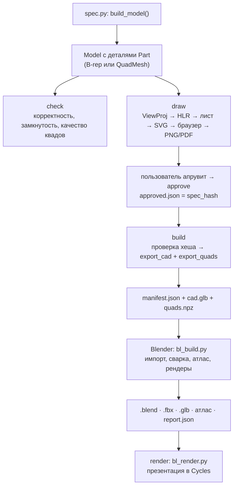
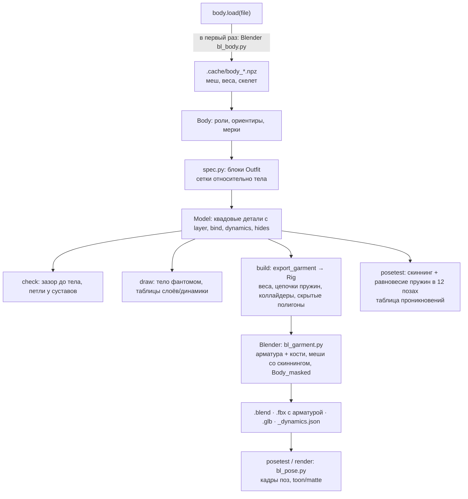

# Архитектура

[English version](architecture.en.md) · [Карта документации](README.ru.md)

Как устроен Blueprint3D: через какие этапы проходит спецификация, какой компонент за что отвечает, как сторона Python общается с Blender и на каких инвариантах держится устройство. Подробности до уровня функций — в [справочнике модулей](modules.ru.md); файлы и ключи — в [форматах файлов](file-formats.ru.md).

## Идея

Одно параметрическое описание — `spec.py` — единственный источник истины для объекта. И чертёж, и 3D-модель **выводятся** из одних и тех же тел, поэтому расходиться не могут. Человек апрувит чертёж; апрув привязан к хешу всего, что определяет геометрию, поэтому модель, собранная по апрувнутому чертежу, доказуемо имеет апрувнутую геометрию.

## Компоненты

| Слой | Модули | Отвечает за |
|---|---|---|
| Командная строка | `__main__.py` | Команды, загрузка спецификации, хеш апрува и его проверка, конфигурация проекта, печать через браузер, selftest |
| Модель данных | `model.py` | `Model`, `Part`, отделки, палитра, перечень позиций (BOM) |
| Геометрия | `kit.py`, `mesh.py`, `folds.py` | Построение B-rep (контуры, призмы, лофты, B-сплайн-лоскуты, оболочки) и квадовые меши из тех же сеток |
| Чертёж | `drawing.py` | Проекция, удаление скрытых линий, разрезы, выносные виды, размеры, таблицы, штамп, SVG |
| Персонажи | `body.py`, `garment.py`, `rig.py`, `posetest.py`, `mannequin.py` | Тело с ригом как данные, блоки одежды, привязка и кости с пружиной, тест поз, манекен, собранный кодом |
| 3D-экспорт | `build.py` | Поиск Blender, запись манифестов/glTF/npz, запуск скриптов Blender |
| Сторона Blender | `bl_*.py` | Сборка `.blend`/`.fbx`/`.glb`, запекание атласа, рендеры, экспорт тела, пересборка манекена |

## Конвейеры

### Жёсткий предмет

1. **Построение.** `build_model()` возвращает `Model`. Детали — либо твёрдые тела B-rep (`mesh="cad"`), либо объекты `QuadMesh` (`mesh="quad"`); для квадовой детали `Model.add` также сохраняет `QuadMesh.brep()` — B-сплайн-грани через те же сетки, — чтобы у чертежа была точная геометрия для проекции.
2. **Проверка.** Каждая деталь проверяется: корректность и замкнутость B-rep; для квадовых мешей — многообразность, порядок обхода, вырожденные грани, соотношение сторон и отклонение от B-сплайна.
3. **Чертёж.** Виды проецируются с удалением скрытых линий OpenCascade (точным или полигональным при `hlr="poly"`); разрезы пересекают B-rep плоскостями (квадовые детали режутся как меши); размеры, выноски и таблицы раскладываются в миллиметрах листа; SVG печатается в PNG/PDF браузером без интерфейса.
4. **Апрув.** Человек смотрит лист и апрувит его; `approved.json` хранит хеш спецификации и модулей геометрии.
5. **Сборка.** Хеш проверяется ещё раз; CAD-детали тесселируются в glTF, квадовые детали пишутся в `.npz` с UV, упакованными в атлас; Blender собирает сцену, сваривает, запекает цветовой атлас, рендерит проверочные кадры и экспортирует.
6. **Рендер.** Необязательные презентационные рендеры с процедурными материалами по отделке.

### Одежда

Тот же каркас с тремя добавлениями — тело, риг и тест поз:

- Тело читается один раз через Blender и кэшируется как массивы numpy; вся остальная работа на стороне Python идёт с этими массивами.
- Блоки одежды строят сетки **относительно ориентиров тела** и выталкивают их из тела на зазор слоя; те же сетки становятся квадовым мешем и B-rep чертежа.
- `Rig` переносит веса с поверхности тела, генерирует цепочки костей с пружиной и коллайдеры и находит полигоны тела, закрытые одеждой.
- `posetest` деформирует одежду теми же весами, что идут в FBX, и измеряет проникновения в тело и между слоями.

## Модель процессов

Blueprint3D работает в **двух средах Python**: собственный venv инструмента (build123d, numpy, scipy) и встроенный Python Blender (`bpy`). Они никогда не импортируют друг друга; они обмениваются файлами.

| Вызов | Флаги Blender | Вход | Выход | Признак успеха |
|---|---|---|---|---|
| `build` (жёсткий предмет) | `-b --factory-startup` | `manifest.json`, `cad.glb`, `quads.npz` | файлы модели, `report.json`, `blender.log` | `BP3D_DONE` + существует `report.json` |
| `build` (одежда) | `-b --factory-startup` | то же + `rig` в манифесте, массивы `WI`/`WW` | + арматура, `Body_masked` | `BP3D_DONE` |
| экспорт тела | `-b --factory-startup` | файл тела | `.cache/body_<hash16>.npz` | `BP3D_DONE` |
| `render` (жёсткий предмет) | `-b <model.blend>` (профиль пользователя) | — | рендеры, `render_<color>.json` | `BP3D_RENDER_DONE` |
| `posetest`/`render` (одежда) | `-b <model.blend>` (профиль пользователя) | `_shots.json` | PNG, `renders.json` | `BP3D_DONE` |
| `mannequin` | `-b` с `BLENDER_USER_RESOURCES` (MPFB) или `--factory-startup` | `macro.json` или `_parts.npz` + `_skeleton.json` | `bodies/<name>/<name>.blend`, превью | `BP3D_DONE` |

Правила границы:
- Аргументы — после `--` в командной строке Blender; данные — в файлах рядом с результатом.
- Скрипт печатает свой признак только после того, как записал всё; сторона Python считает сбоем отсутствие признака, ненулевой код выхода или отсутствие отчёта и показывает конец `blender.log`.
- У подпроцессов Blender нет тайм-аута.

Браузер — третий внешний процесс: Edge/Chrome/Chromium без интерфейса печатает SVG в PNG (`--screenshot`) и PDF (`--print-to-pdf`). Его сбои не фатальны — `draw` всё равно пишет SVG; `selftest --draw` обнаруживает отсутствие PNG.

## Апрув и воспроизводимость

`spec_hash` = SHA-256 по порядку от: `spec.py`, `kit.py`, `mesh.py`; для спецификаций с телом также `body.py`, `garment.py`, `rig.py` и `source_hash` каждого тела (хеш файла тела плюс переопределения `roles`/`landmarks`). Переводы строк нормализуются, поэтому хеш не зависит от autocrlf в Git.

- `approve` сохраняет его; `build` отказывается работать, если хеша нет или он другой. `--force` собирает **черновик** и помечает его в `report.json` (`draft: true`).
- Хеш печатается на листе и пишется в каждый отчёт (`report.json`, отчёт posetest, JSON рендера), поэтому любой результат можно отследить до точной спецификации.
- Не хешируются: `drawing.py`, `build.py`, `model.py`, `bl_*.py`, `bp3d.json`, вспомогательные модули рядом со спецификацией. Их изменение не делает апрувы недействительными — не держите в них решений по геометрии.
- Результаты (`out/`) никогда не хранятся в Git: они воспроизводятся из `spec.py` + версии инструмента.

## Системы координат

| Пространство | Оси | Единицы | Где |
|---|---|---|---|
| Спецификация / CAD | X назад от передней точки, Z вверх от земли; левая сторона персонажа — −Y (персонаж смотрит в −X) | мм | спецификации, `kit`, `mesh`, `body` |
| Лист | x вправо, y вниз от левого верхнего угла листа | мм листа (масштаб вида `k` = мм листа на мм модели) | `drawing` |
| Сцена Blender | перед смотрит в −Y, Z вверх; левая рука персонажа к +X | м | `bl_*`; преобразование `cad_to_bl(x, y, z) = (−y, x, z) · 0.001` (`bl_common`) |
| Импорт тела | Blender → CAD `(X, Y, Z) → (Y, −X, Z) · 1000` | | `bl_body` |
| FBX | оси Unity: вперёд −Z, вверх Y, масштаб по единицам | м | экспорт `bl_build`, `bl_garment` |
| JSON динамики | доли относительно кости и метры | м | `rig.dynamics_manifest` |

## Кэши и состояние на диске

| Путь | Содержимое | Сброс |
|---|---|---|
| `.cache/body_<sha16>.npz` | Экспортированное тело (вершины, треугольники, нормали, веса, скелет) | Ключ — только хеш файла тела; после изменения `bl_body.py` удалите папку |
| `<object>/out/` | Все результаты | Перезаписывается следующим запуском; устаревшие файлы удалённых деталей остаются — для чистого состояния удалите `out/` |
| `examples/*/out/` | Результаты `selftest` | Так же |

## Инварианты, на которых держится устройство

- **Одно построение, два представления.** Чертёж и модель получаются из одних и тех же тел/сеток. Никогда не чертите то, что не смоделировано, и не моделируйте то, что не начерчено.
- **Сетки не передискретизируются.** У квадового меша ровно те ряды, что дала спецификация; топология задаётся в спецификации (`spacing`, `cols`, `row_step`).
- **Нормали наружу.** Нормаль сетки `du × dv` смотрит наружу; толщина растёт внутрь. Соседние лоскуты делят ряд точно; этот ряд становится линией излома на чертеже и сваренным швом в меше.
- **Апрув явный и с хешем.** Ни один путь в коде не собирает нечерновую модель без совпадающего апрува.
- **Детерминированные результаты.** Та же спецификация + та же версия инструмента → та же геометрия и тот же хеш.

## Точки расширения

| Что добавить | Где | См. |
|---|---|---|
| Команда | `__main__.py` | [руководство разработчика](development.ru.md#новая-команда-cli) |
| Примитив геометрии / построитель квадов | `kit.py` / `mesh.py` | [руководство разработчика](development.ru.md#функция-геометрии-kitpy-или-построитель-квадов-meshpy) |
| Элемент листа | `drawing.py` | [руководство разработчика](development.ru.md#ключ-листа) |
| Блок одежды | `garment.py` | [руководство разработчика](development.ru.md#блок-одежды) |
| Отделка / материал | `model.py`, `bl_render.py`, `bl_pose.py` | [руководство разработчика](development.ru.md#отделка) |
| Тело | `bodies/` или любой файл с ригом | [bodies/README.md](../bodies/README.md) |
| Интеграция с движком (кости с пружиной) | читать `<name>_dynamics.json` | [форматы файлов](file-formats.ru.md#name_dynamicsjson) |
